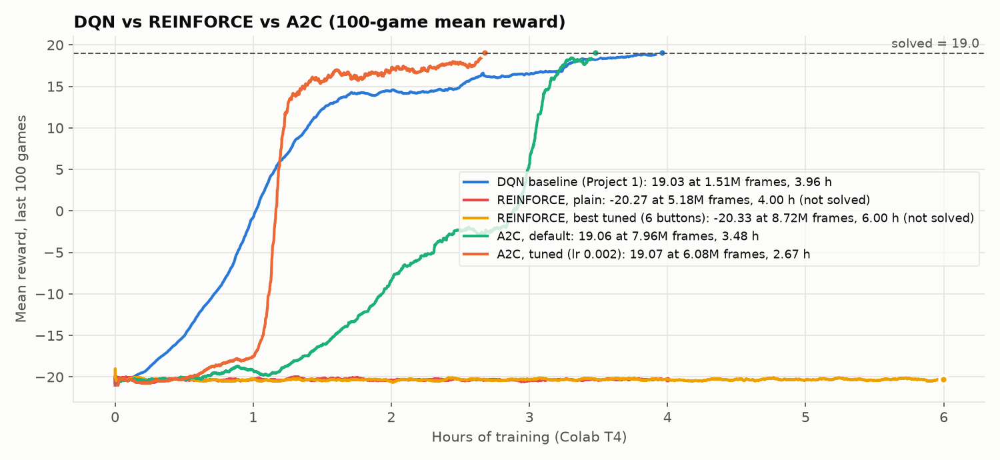
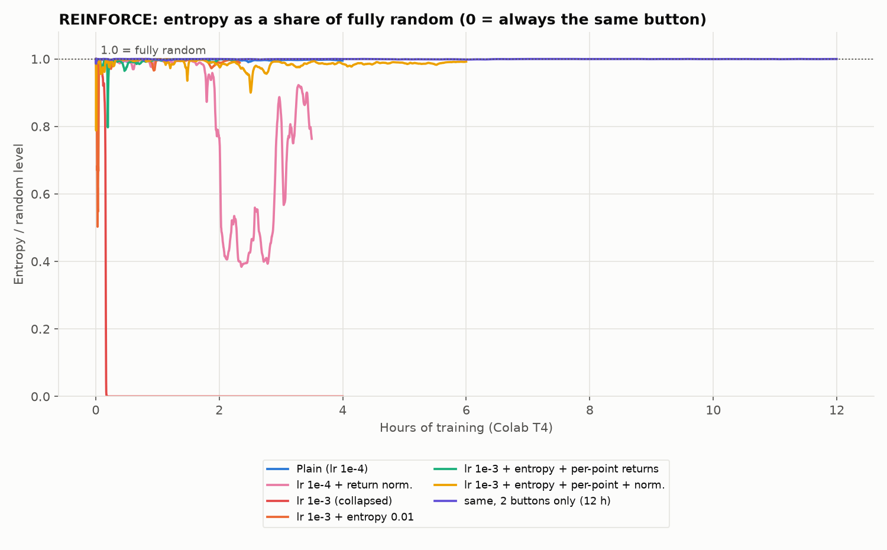
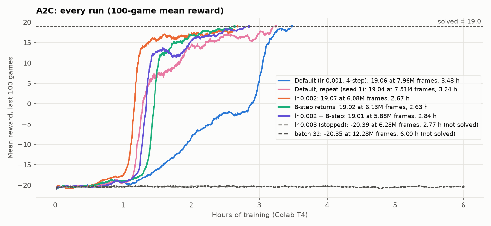

# CMPE 260 Project 2: Policy Gradients on Atari Pong

**Team:** Shreram Palanisamy, Sankalp Wahane

We train two policy-gradient methods on Pong and compare them with the DQN from [Project 1](../pong-dqn/):
1. **REINFORCE** (Williams, 1992) as the policy-gradient baseline, then tuned,
2. **A2C**, Advantage Actor-Critic (Mnih et al., 2016), tuned.

Settings are the same as Project 1: `PongNoFrameskip-v4`, the Project 1 wrappers (`lib/wrappers.py`), the same convolutional network body, γ = 0.99, Google Colab with a Tesla T4 for every run, and "solved" = the 100-game mean reward passes 19.0.

## Results in short

| | DQN (Project 1 baseline) | REINFORCE (best tuned, 6 h) | A2C (tuned, lr 0.002) |
|---|---|---|---|
| Solved (100-game mean ≥ 19)? | Yes, 19.03 | **No**, −20.33 | Yes, 19.07 |
| Training time (T4) | 3.96 h | not solved in 6 h (or 12 h) | **2.67 h** |
| Frames (samples) | **1.51M** | 8.72M, no learning | 6.08M |
| Games played | **670** | 9,392 | 3,445 |
| Learning steps (updates) | ~1.5M | 2,348 | 47,460 |
| Frames per learning step | 32 (each frame reused ~32×) | ~3,700 (4 whole games) | 128 (each frame used once) |
| Speed | ~105 frames/s | ~410 frames/s | **~630 frames/s** |
| Bias / overestimation | Overestimates (max over noisy Q-values) | No bias, very high variance | Small bias, low variance |

- **A2C solved Pong, and tuning made it about a quarter faster.** Learning rate 0.002 reached 19 in 2.67 h and 6.08M frames, against 3.48 h and 7.96M for the book's defaults (−24% frames). Repeating the default with a new seed changed the result by only 6%, so the gain is not luck.
- **REINFORCE never learned in our time budget.** Seven runs, up to 12 hours and 16,306 games, all stayed at random-play level (about −20.3). Tuning changed its behaviour (an entropy bonus prevented a collapse; per-point returns cut the noise in the returns by 56%) but not its score.
- **DQN needs the fewest frames; tuned A2C needs the least time.** DQN reuses every frame about 32 times from its replay buffer, so it needs 4× fewer frames but trains slowly. A2C uses each frame once but plays 50 games at once, so its frames are cheap.



## REINFORCE: every run

`1_reinforce.py` defaults to plain REINFORCE: learning rate 1e-4, 4 games per update, Adam, no extras. Random play scores about −20.3.

| Notebook | What we changed | Why | Result |
|---|---|---|---|
| `Pong2_reinforce_untuned` | Nothing (baseline) | Plain algorithm, as the brief asks | −20.27 after 4 h; entropy stayed at 1.79 (random) |
| `Pong2_reinforce_norm` | `--return-norm meanstd` | Return normalization, a simple variance reduction | −20.36 after 3.5 h; no effect |
| `Pong2_reinforce_lr0.001` | `--lr 0.001` | The baseline barely moved | **Collapsed within 15 min**: one button, every game −21 |
| `Pong2_reinforce_lr0.001_ent0.01` | + `--entropy-beta 0.01` | Prevent the collapse | No collapse; −20.27, still random (2.3 h, Colab disconnect) |
| `Pong2_reinforce_lr0.001_ent0.01_pt` | + `--point-returns` | Judge each move by its own point (Karpathy, 2016) | Return spread −56% (0.73 → 0.32); −20.31 (2.3 h, disconnect) |
| `Pong2_reinforce_pt_norm` | + `--return-norm meanstd`, 6 h | Every fix together, longer | −20.33 after 6 h, 9,392 games |
| `Pong2_reinforce_pt_norm_a2` | + `--two-actions`, 12 h | Pong's 6 buttons are 3 moves; Karpathy used UP/DOWN | −20.36 after 12 h, 16,306 games |

**Why it failed:** one learning step per 4 whole games (about 1,400 in 4 hours) from a very noisy signal, with no critic to tell a good move from a lucky one. At learning rate 1e-3 the policy became nearly deterministic, which leaves almost no gradient to recover with (gradient norm 0.05 → 0.006).

**Other evidence:** the book author's own policy-gradient run on Pong (`Chapter09/res/...pong-pg-bad`, already with a baseline, entropy bonus, 10-step returns and 32 environments) stayed at −20.26 after 7.1M frames and 3.6 h. Karpathy (2016) did get REINFORCE to beat the built-in AI slightly, but after about three days of training with a much simpler setup (a small fully-connected network on difference frames, 2 actions, RMSProp, 10 games per update). We kept the Project 1 setup that the brief requires.



## A2C: every run

`2_a2c.py` is a port of the book's Chapter 10 A2C with its defaults: learning rate 0.001, 50 environments, batch 128, 4-step returns, entropy bonus 0.01, gradient clipping 0.1.

| Notebook | What we changed | Why | Frames to 19 | Hours | Result |
|---|---|---|---|---|---|
| `Pong2_a2c_untuned` | Nothing (book defaults) | Starting point | 7,958,200 | 3.48 | Solved, 19.06 |
| `Pong2_a2c_untuned_seed1` | `--seed 1` | How much does luck alone change? | 7,508,200 | 3.24 | Solved, 19.04 (6% faster) |
| `Pong2_a2c_lr0.003` | `--lr 0.003` | The author's best setting | — | 2.77 | Never learned (−20.39) |
| `Pong2_a2c_b32` | `--batch-size 32` | The author's other suggestion | — | 6.00 | Never learned (−20.35) |
| `Pong2_a2c_lr0.002` | `--lr 0.002` | Between what worked (0.001) and failed (0.003) | **6,076,050** | **2.67** | **Solved, 19.07 (−24% frames)** |
| `Pong2_a2c_n8` | `--reward-steps 8` | More real reward per update, less reliance on the early critic | **6,133,200** | **2.63** | **Solved, 19.02 (−23% frames)** |
| `Pong2_a2c_lr0.002_n8` | both | Do the two gains stack? | 5,875,200 | 2.84 | Solved, 19.01 (no extra gain in time) |

- **lr 0.002** lets the policy leave random play sooner: its entropy starts dropping at about 1.5M frames, against about 2.2M for the default. At 0.003 the policy is pushed around before the critic has learned, and it never settles.
- **8-step returns** put more real reward into each update, so early learning depends less on a critic that is still inaccurate (less bias, slightly more variance).
- **The critic learned even in the failed runs:** its value settled at about −2, the correct discounted return for random play (losing a point roughly every 44 moves). The actor never improved.
- **Every solved run** sat near −20 for about an hour, then climbed from −20 to +15 within about 20 minutes.



## Why the three methods differ

1. **Off-policy vs on-policy.** DQN stores moves in a replay buffer and reuses each about 32 times: few frames, but every frame costs a training step. REINFORCE and A2C can learn only from the current policy's games and discard each frame after one use: about 4× more frames, but each one is cheap.
2. **A critic vs whole games.** A2C's critic lets it judge each move after a few steps and update every 128 moves. REINFORCE waits for whole games and learns from their noisy final score, so it gets few, weak updates.
3. **Bias vs variance.** REINFORCE's returns are unbiased but very noisy. DQN's max over noisy Q-values overestimates (van Hasselt et al., 2016). A2C accepts a small bias from its critic in exchange for much lower variance, the best balance on Pong.

## Team contributions

| Part | Contributor |
|---|---|
| **REINFORCE**: baseline and all tuning runs (`1_reinforce.py`) | **Sankalp Wahane** |
| **A2C**: baseline and all tuning runs (`2_a2c.py`) | **Shreram Palanisamy** |

Code was developed with the assistance of an AI coding tool (Claude Code). Every design decision and its source is documented in this README and in `colab/colab_commands.md`.

## Files

| File | What it is |
|---|---|
| `1_reinforce.py` | REINFORCE. Defaults are plain REINFORCE; tuning flags: `--lr`, `--games-per-update`, `--entropy-beta`, `--return-norm`, `--grad-clip`, `--point-returns`, `--two-actions` |
| `2_a2c.py` | A2C, ported from the book's Chapter 10 code with its default hyperparameters; tuning flags: `--lr`, `--envs`, `--batch-size`, `--reward-steps`, `--entropy-beta`, `--grad-clip` |
| `lib/wrappers.py` | Atari preprocessing, identical to Project 1 |
| `lib/pg_models.py` | Policy network (REINFORCE) and actor-critic network (A2C) |
| `colab/colab_commands.md` | Exact Colab cells and command for every run, plus the TensorBoard comparison notebook |
| `results/tensorboard/Pong2_*/` | TensorBoard file of every run, one folder per Colab notebook |
| `results/tensorboard_screenshots/` | TensorBoard screenshots: `a2c/`, `reinforce/`, `comparison/` |
| `results/logs/Pong2_*.log` | Full training log of every run |
| `results/plots/` | Report graphs drawn from the TensorBoard files by `tools/plot_runs.py` |
| `tools/plot_runs.py` | Redraws the graphs (needs matplotlib, no TensorFlow) |
| `presentation/CMPE260_Project2_Presentation.pptx` | Class presentation (11 slides) |

Both scripts take `--max-hours` to cap a run, save the best model as a `.dat` file, and log to TensorBoard (`runs/`).

## How to run

```bash
git clone https://github.com/shreramsp/deep-rl-labs.git && cd deep-rl-labs/pong-pg
pip install torch "gymnasium[atari]" ale-py opencv-python-headless tensorboardX
python 1_reinforce.py --cuda --max-hours 4        # plain REINFORCE (Pong2_reinforce_untuned)
python 2_a2c.py --cuda --max-hours 6              # A2C with the reference defaults (Pong2_a2c_untuned)
python 2_a2c.py --cuda --lr 0.002 --max-hours 6   # tuned A2C (Pong2_a2c_lr0.002)
tensorboard --logdir results/tensorboard          # view our recorded runs
python tools/plot_runs.py                         # redraw the graphs (needs matplotlib)
```

The exact command of every run is in `colab/colab_commands.md`. Each script stops on its own when the 100-game mean exceeds 19.0 or the `--max-hours` cap is reached, saving the best model as a `.dat` file. Model files are excluded from git.

## References
1. Williams, R. J. (1992). Simple statistical gradient-following algorithms for connectionist reinforcement learning. *Machine Learning*, 8.
2. Mnih, V., et al. (2016). Asynchronous methods for deep reinforcement learning. *ICML*.
3. Lapan, M. *Deep Reinforcement Learning Hands-On*, Chapters 9–10. Packt.
4. Karpathy, A. (2016). Deep Reinforcement Learning: Pong from Pixels. Blog post, http://karpathy.github.io/2016/05/31/rl/ (per-point returns, `--point-returns`; UP/DOWN only, `--two-actions`).
5. van Hasselt, H., Guez, A., and Silver, D. (2016). Deep reinforcement learning with double Q-learning. *AAAI*.
6. Mnih, V., et al. (2015). Human-level control through deep reinforcement learning. *Nature*, 518.
